<div align="center">

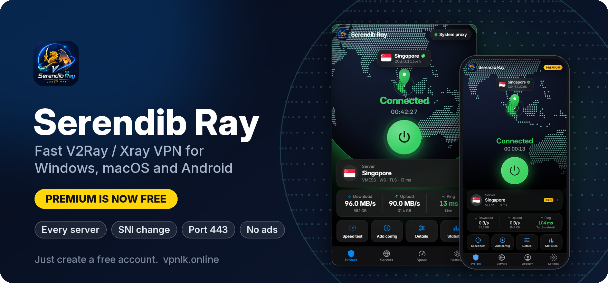

<br>
<br>

<a href="https://github.com/Dinith-k/serendib-ray-downloads/releases/latest"></a>


<br>
<br>

<a href="https://github.com/Dinith-k/serendib-ray-downloads/releases/download/v0.8.1/Serendib-Ray-Setup-0.8.1.exe"></a>
<a href="https://github.com/Dinith-k/serendib-ray-downloads/releases/download/v0.8.1/Serendib-Ray-0.8.1-mac-arm64.dmg"></a>
<a href="https://github.com/Dinith-k/serendib-ray-downloads/releases/download/v0.8.1/Serendib-Ray-Pro-2.0.1.apk"></a>

<sub>Mac with an Intel chip? <a href="https://github.com/Dinith-k/serendib-ray-downloads/releases/download/v0.8.1/Serendib-Ray-0.8.1-mac-x64.dmg">Get the Intel version</a> &nbsp;·&nbsp; <a href="https://github.com/Dinith-k/serendib-ray-downloads/releases/latest">All files and checksums</a></sub>

<br>

**[What's new](#-whats-new)** &nbsp;·&nbsp; **[Screenshots](#-screenshots)** &nbsp;·&nbsp; **[Features](#-features)** &nbsp;·&nbsp; **[Download](#-download)** &nbsp;·&nbsp; **[Install](#-install-guides)** &nbsp;·&nbsp; **[Questions](#-questions)**

</div>

<br>

> [!TIP]
> ### 🎉 Premium is now free for everyone
> Every server, the SNI change and the port 443 servers are free in all the apps. Just **create a free account** in the app (or at [vpnlk.online](https://vpnlk.online/signup)). No trial, no plans, nothing runs out, and no ads.

<br>

## 🆕 What's new

<table>
<tr>
<td width="50%" valign="top">

#### 💻 Windows and Mac &nbsp;<sup><code>0.8</code></sup>

- 🎨 **A brand new look**, with the animated globe that flies to your server when you connect
- 🔐 **Sign in or create an account** right in the app: Premium is free
- 🧩 **Choose which apps use the VPN**: pick running programs, save the list, and send only them (or everything except them) through the tunnel
- ⚡ **Speed test** screen: download, upload, latency and jitter through the VPN
- 🛡️ **Whole PC mode is much more stable**: it connects first time and stays connected
- 🌗 Light and dark themes, and your live speed on the home screen

</td>
<td width="50%" valign="top">

#### 🤖 Android, Serendib Ray Pro &nbsp;<sup><code>2.0</code></sup>

- 🎨 **The new design** from the Google Play app, globe animation included
- 🔐 **Sign in or create an account**: Premium is free
- 👤 A new **Account** tab
- 🚫 **No ads**, never
- 🧭 SNI change and port 443 servers for everyone
- ⬆️ Installs over the older Pro app

</td>
</tr>
</table>

---

## 📸 Screenshots

### 💻 Windows and Mac

<table>
<tr>
<td align="center" width="33%">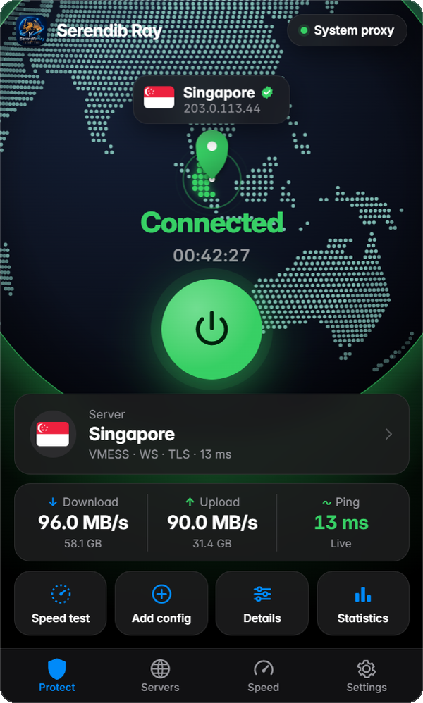<br><b>One click to connect</b><br><sub>The globe flies to your server</sub></td>
<td align="center" width="33%">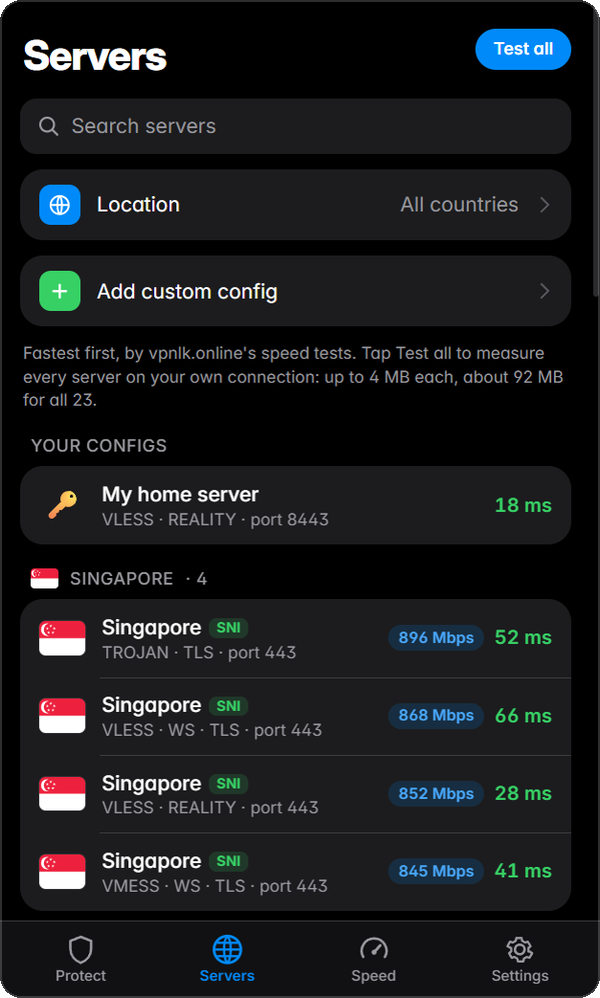<br><b>Fastest servers first</b><br><sub>Checked again every hour</sub></td>
<td align="center" width="33%">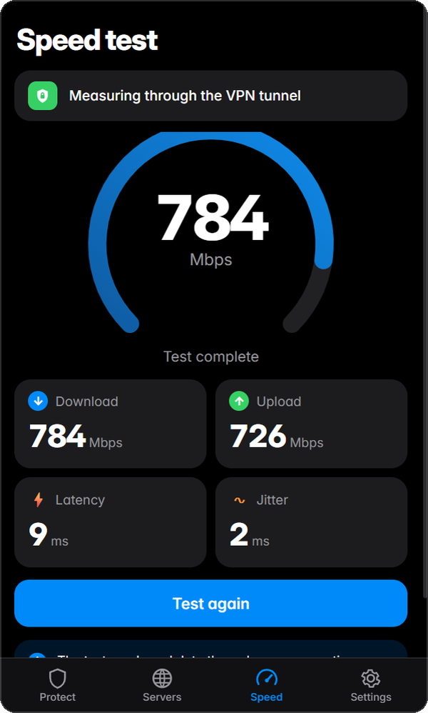<br><b>Speed test</b><br><sub>Through the VPN tunnel</sub></td>
</tr>
<tr>
<td align="center">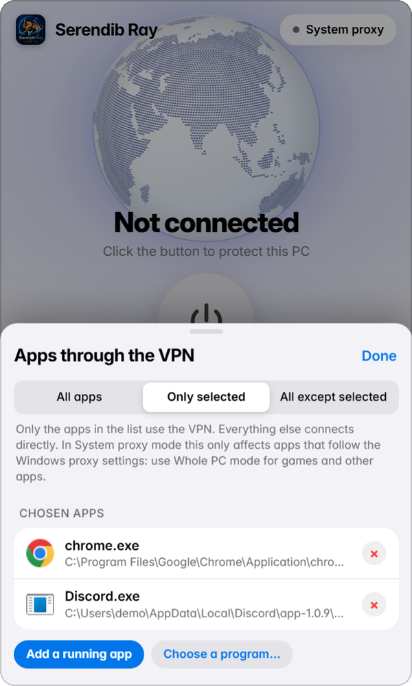<br><b>Apps through the VPN</b><br><sub>All, only some, or all except some</sub></td>
<td align="center">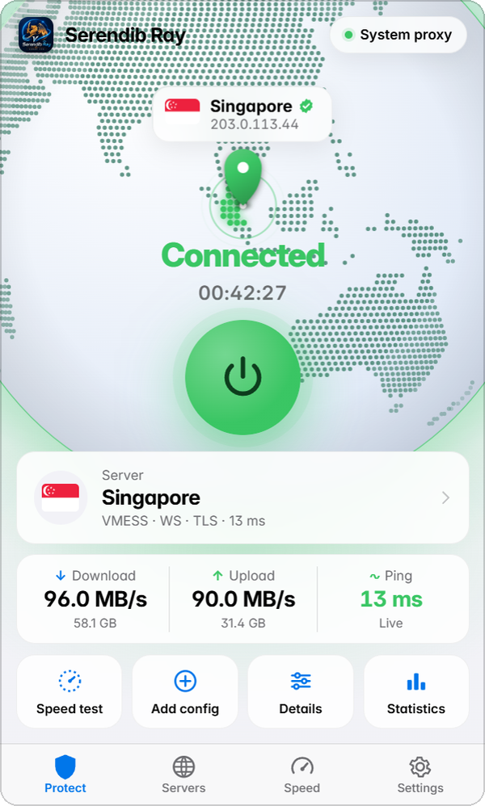<br><b>Light or dark</b><br><sub>Follows your computer</sub></td>
<td align="center">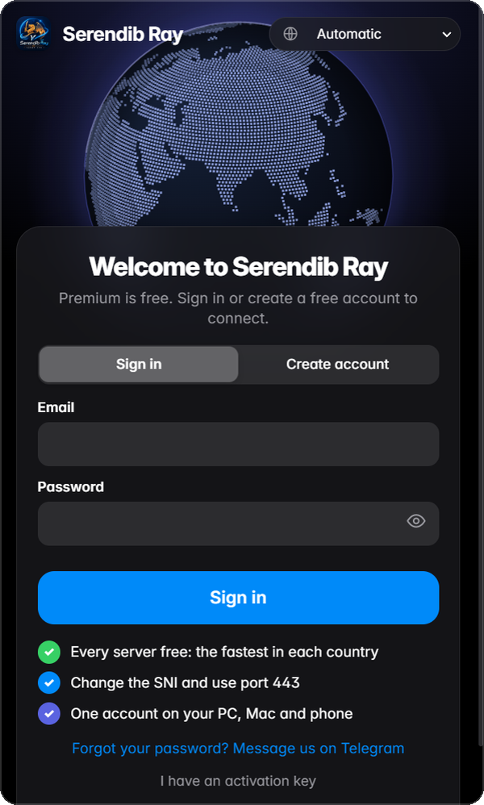<br><b>Free account</b><br><sub>Sign in once, that's it</sub></td>
</tr>
</table>

### 🤖 Android (Serendib Ray Pro)

<table>
<tr>
<td align="center" width="25%">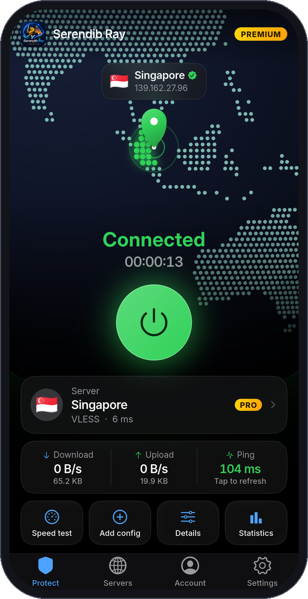<br><b>Connect</b></td>
<td align="center" width="25%">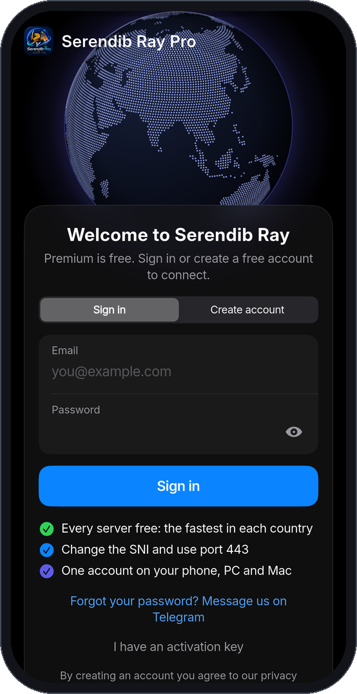<br><b>Sign in</b></td>
<td align="center" width="25%">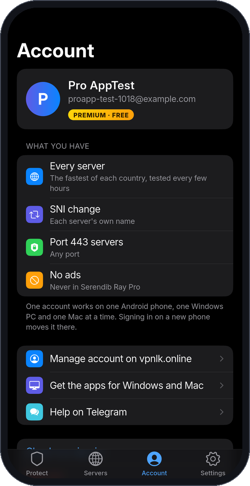<br><b>Account</b></td>
<td align="center" width="25%">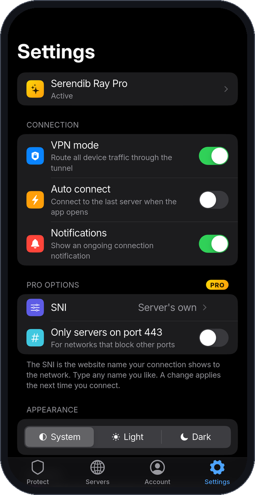<br><b>Settings</b></td>
</tr>
</table>

---

## ✨ Features

| 🚀 Fastest first | 🧪 Always tested | 🔓 Free Premium |
|:--|:--|:--|
| The fastest servers of each country (up to 6, and up to 20 in Singapore), sorted by speed, with the latest speed test next to each one. | Every listed server is checked again every hour, and the SNI and port 443 servers every 15 minutes. Dead ones are removed. | Every server, the SNI change and port 443 are free with an account. Nothing to buy and nothing runs out. |

| 🧭 Change the SNI | 🎯 Port 443 | 🧩 Apps through the VPN |
|:--|:--|:--|
| Pick a tested name or type any name you like. Some networks block one name and allow another. | One switch keeps only servers on port 443, which networks that block other ports usually still allow. | On Windows, choose the programs that use the VPN (or the ones that don't). The list is saved for next time. |

| 🖥️ Whole PC mode | 📱 One account, three devices | 🚫 No ads |
|:--|:--|:--|
| On Windows, send games and every other app through the VPN, not just the ones that follow the proxy settings. | One Windows PC, one Mac and one Android phone at the same time. | No ads in any of these apps, and no ad code inside Serendib Ray Pro. |

### What each app has

| | 💻 Windows | 🍎 macOS | 🤖 Android (Pro) |
|:--|:-:|:-:|:-:|
| Free account: every server, SNI change, port 443 | ✅ | ✅ | ✅ |
| Fastest servers first, with their speed | ✅ | ✅ | ✅ |
| Globe animation, light and dark themes | ✅ | ✅ | ✅ |
| Speed test and usage statistics | ✅ | ✅ | ✅ |
| Add your own `vless://` `vmess://` `trojan://` `ss://` links | ✅ | ✅ | ✅ |
| **Test all** servers from your own connection | ✅ | ✅ | ➖ |
| 12 languages, including Sinhala and Tamil | ✅ | ✅ | ➖ |
| Choose which apps go through the VPN | ✅ | ➖ | ➖ |
| Whole PC mode | ✅ | ➖ | ➖ |
| Starts with Windows and connects by itself | ✅ | ➖ | ➖ |
| Updates itself | ✅ | ➖ | ➖ |
| No ads | ✅ | ✅ | ✅ |

---

## 📲 Download

| | Platform | File | Size | Needs |
|:-:|:--|:--|--:|:--|
| 💻 | **Windows** | [Serendib-Ray-Setup-0.8.1.exe](https://github.com/Dinith-k/serendib-ray-downloads/releases/download/v0.8.1/Serendib-Ray-Setup-0.8.1.exe) | 123 MB | Windows 10 or 11, 64-bit |
| 🍎 | **macOS, Apple silicon** | [Serendib-Ray-0.8.1-mac-arm64.dmg](https://github.com/Dinith-k/serendib-ray-downloads/releases/download/v0.8.1/Serendib-Ray-0.8.1-mac-arm64.dmg) | 143 MB | Mac with M1, M2, M3 or M4 |
| 🍎 | **macOS, Intel** | [Serendib-Ray-0.8.1-mac-x64.dmg](https://github.com/Dinith-k/serendib-ray-downloads/releases/download/v0.8.1/Serendib-Ray-0.8.1-mac-x64.dmg) | 152 MB | Mac with an Intel chip |
| 🤖 | **Android, Serendib Ray Pro** | [Serendib-Ray-Pro-2.0.1.apk](https://github.com/Dinith-k/serendib-ray-downloads/releases/download/v0.8.1/Serendib-Ray-Pro-2.0.1.apk) | 69 MB | Android 7.0 or newer |

Not sure which Mac you have? Apple menu > **About This Mac**: "Chip: Apple M…" is Apple silicon, "Processor: Intel…" is Intel.

## 🚀 Get started in 3 steps

| 1️⃣ Download | 2️⃣ Sign in | 3️⃣ Connect |
|:--|:--|:--|
| Get the file for your device from the table above and install it ([how](#-install-guides)). | Open the app and **create a free account** (name, email, phone number and a password), or sign in. | Press the power button. You are now on the fastest server. |

---

## 📖 Install guides

<details>
<summary><b>💻 Windows</b></summary>

<br>

1. Run the downloaded file and follow the steps. It installs just for you. The app asks Windows for administrator permission each time you open it by hand (it needs that for the system proxy and Whole PC mode); when it starts at sign-in it does so without a prompt.
2. If Windows says it protected your PC, choose **More info**, then **Run anyway**. The installer is not code-signed yet, so Windows does not know the publisher (**Aplogon**).
3. On the last page, leave **Run on startup and connect automatically** ticked if you want it to start by itself when you sign in to Windows. You can turn it off any time in **Settings**.
4. Sign in, or create your free account.

The close button asks whether to **minimize to the tray** or **quit**, and the tray icon can connect, disconnect and quit.

**Updates:** the installed app checks for new versions by itself and installs them when you close it, or when you press **Restart and update** (**Settings > App updates**). Already have an older version? It updates to this one by itself.

</details>

<details>
<summary><b>🍎 macOS</b></summary>

<br>

1. Open the downloaded `.dmg` and drag **Serendib Ray** into **Applications**.
2. The first time, open it with **right-click > Open**, then **Open** again. The app is not notarized by Apple yet, so a plain double-click shows a warning.
3. Sign in, or create your free account.

> [!WARNING]
> **Early build.** The macOS version passes its automated tests on a Mac, but it is new. If macOS asks for your password when connecting, that is the app changing the network proxy settings.

</details>

<details>
<summary><b>🤖 Android (Serendib Ray Pro)</b></summary>

<br>

1. Open this page on your phone and download the `.apk`.
2. Open the downloaded file. Android asks you to allow installing apps from this source (your browser or Files app): allow it, go back, then tap **Install**.
3. Open **Serendib Ray Pro**, then sign in or create your free account.
4. Tap the power button. Android asks once for permission to set up the VPN connection: choose **OK**.

Serendib Ray Pro is the ad-free version of Serendib Ray. It is not on Google Play, so you install it from this file. It installs **next to** the Serendib Ray app from Google Play and does not replace it. If you have an older Pro version, this one installs over it.

</details>

---

## ❓ Questions

<details>
<summary><b>Is Premium really free?</b></summary>

<br>

Yes. Every server, the SNI change and the port 443 servers are free in the Windows, Mac and Android Pro apps. You only need a free account. There is no trial and no plan, and your account does not run out.

</details>

<details>
<summary><b>Why do I need an account?</b></summary>

<br>

The account keeps the free servers for real people and stops abuse: one free account per person and per device. You make it once, in the app or at [vpnlk.online/signup](https://vpnlk.online/signup), with your name, email, phone number and a password.

</details>

<details>
<summary><b>Can I use one account on more than one device?</b></summary>

<br>

Yes: **one Windows PC, one Mac and one Android phone**, all at the same time. Signing in on a new device of the same kind (a new PC, for example) moves the account there, and the old one is signed out. You can move it up to 3 times a day.

</details>

<details>
<summary><b>I already have an activation key (SRK-…)</b></summary>

<br>

It keeps working and now never expires. If the app was already activated, you stay signed in after the update. On a new device, choose **I have an activation key** under the sign-in form.

</details>

<details>
<summary><b>I forgot my password</b></summary>

<br>

Message us on Telegram **[@ITzz_speed](https://t.me/ITzz_speed)** and we'll help you get back in.

</details>

<details>
<summary><b>What does changing the SNI do?</b></summary>

<br>

The SNI is the server name your connection shows to the network. Some networks block certain names and allow others, so a different name can get through. In **Settings**, pick a tested name to see only the servers that passed a test with it, or type any name you like. With a name you typed yourself every server stays listed, but a server may not accept it, so try another server if it won't connect. The server's certificate is still checked against its own name, so the connection stays safe. A change applies the next time you connect.

</details>

<details>
<summary><b>How do I choose which apps use the VPN? (Windows)</b></summary>

<br>

In **Settings**, open **Apps through the VPN**. Choose **Only selected** (just these apps use the VPN) or **All except selected** (everything except these apps), then **Add a running app** or **Choose a program…**. The list is saved. In **System proxy** mode this only affects apps that follow the Windows proxy settings, like browsers; switch to **Whole PC** mode for games and other apps.

</details>

<details>
<summary><b>System proxy or Whole PC mode? (Windows)</b></summary>

<br>

**System proxy** (the default) is enough for browsers and most apps. **Whole PC** sends everything through the VPN, including games and apps that ignore proxy settings. Change it in **Settings > Mode** (the button at the top of the home screen takes you there).

</details>

<details>
<summary><b>Which languages does the Windows and Mac app speak?</b></summary>

<br>

English, Sinhala (සිංහල), Tamil (தமிழ்), Russian, Hindi, Chinese, Arabic, Persian, Turkish, Spanish, French and Indonesian. It follows your computer's language, and **Settings > Language** changes it at once. The translations were written with machine help, so if a text reads oddly, please tell us.

</details>

<details>
<summary><b>Is the Pro app the same as Serendib Ray on Google Play?</b></summary>

<br>

No, it is a separate app (**Serendib Ray Pro**) with the same new design. It has no ads, and Premium is free in it with your account. You can keep both installed.

</details>

<details>
<summary><b>Does it work if the account server can't be reached?</b></summary>

<br>

The app checks your account when it starts and every few hours. If it can't reach the server it keeps working for up to 3 days, then asks to check in again.

</details>

<details>
<summary><b>Android warns me about installing from outside Google Play</b></summary>

<br>

That is normal for any app that is not from the store. The file is signed by **Aplogon**; you can compare its checksum with the one on this page (see *Check your download* below).

</details>

---

## 🔒 Privacy

About how you use the app, only **totals** are sent to vpnlk.online: the time you were connected, the amount of data, the number of connections and the country of the last server. The sites you visit, the addresses you open and what you do online are never sent. For your account we keep your name, email address and phone number. Read the full text at [vpnlk.online/privacy](https://vpnlk.online/privacy).

## ✅ Check your download

Checksums are in [SHA256SUMS.txt](https://github.com/Dinith-k/serendib-ray-downloads/releases/download/v0.8.1/SHA256SUMS.txt). The result should match the line for your file.

```powershell
# Windows
certutil -hashfile Serendib-Ray-Setup-0.8.1.exe SHA256
```

```bash
# macOS
shasum -a 256 Serendib-Ray-0.8.1-mac-arm64.dmg
```

<details>
<summary>Android: check who signed the APK</summary>

<br>

With the Android SDK tools: `apksigner verify --print-certs Serendib-Ray-Pro-2.0.1.apk`. The signer is **CN=Aplogon** and its certificate SHA-256 is:

```
195ffebc367325d9e3bb72d9629772c02ef24762c4c3ffa7363608e85ba65b36
```

</details>

---

<div align="center">

### 💬 Need help?

<a href="https://t.me/ITzz_speed"></a>
<a href="https://vpnlk.online"></a>

<br>
<br>


<sub>Serendib Ray by <b>Aplogon</b> &nbsp;·&nbsp; made in Sri Lanka 🇱🇰 &nbsp;·&nbsp; <a href="https://vpnlk.online">vpnlk.online</a> &nbsp;·&nbsp; <a href="https://vpnlk.online/privacy">Privacy</a></sub>

</div>

